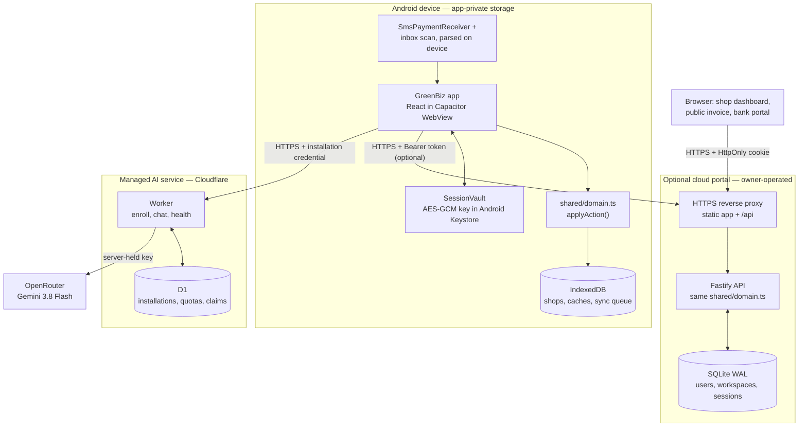
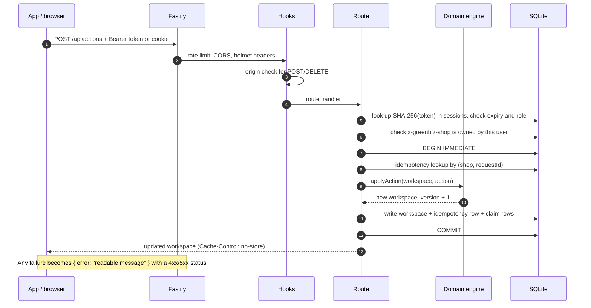
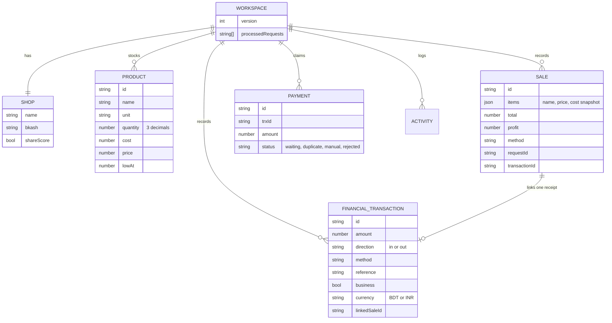
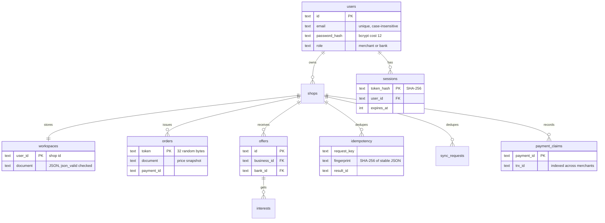
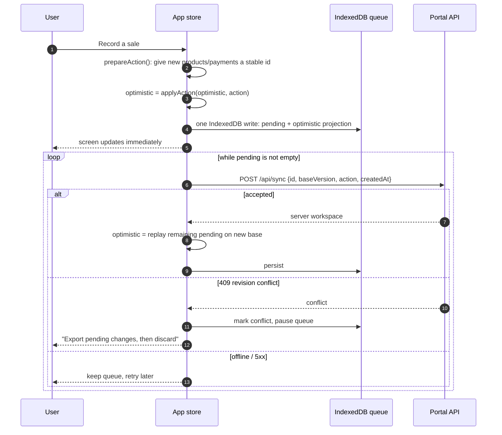
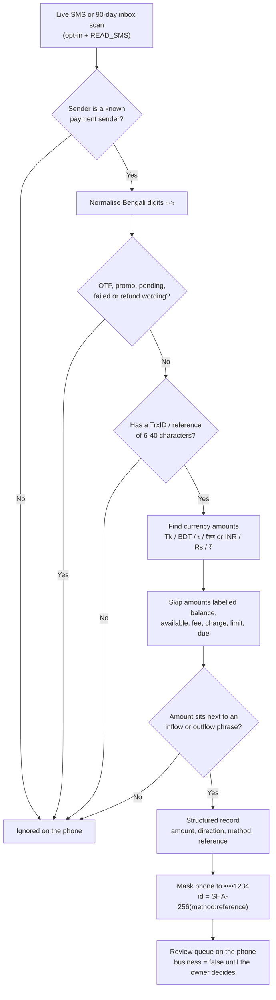
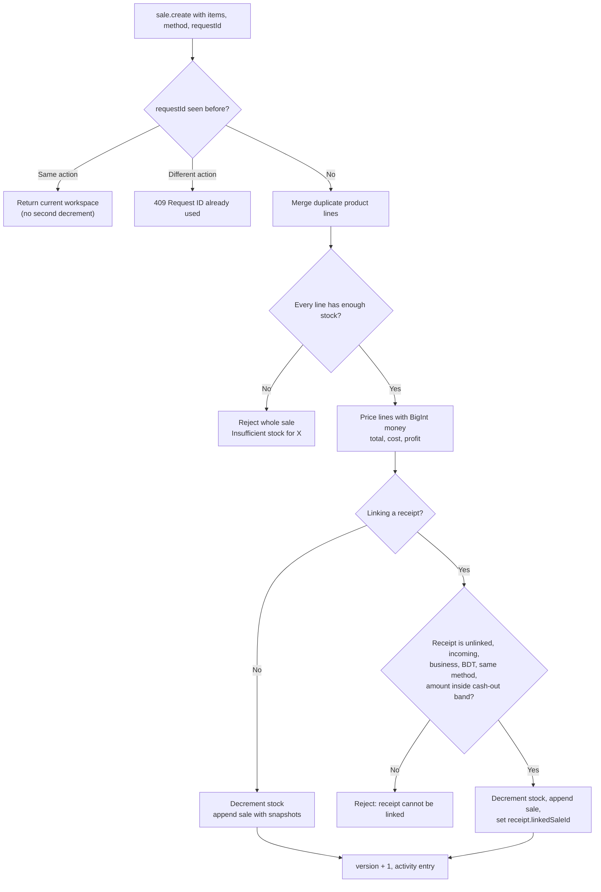
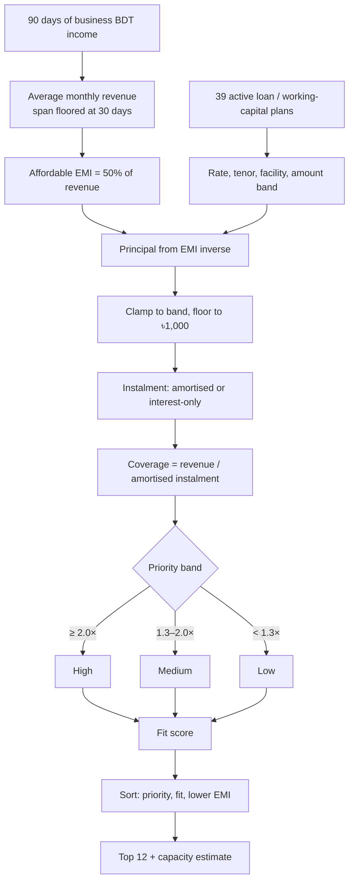
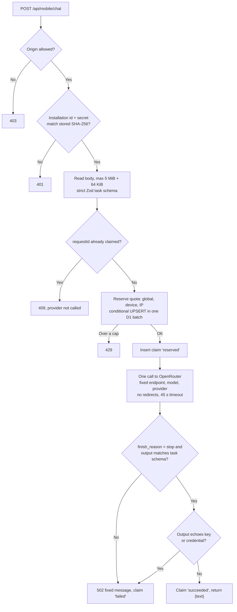
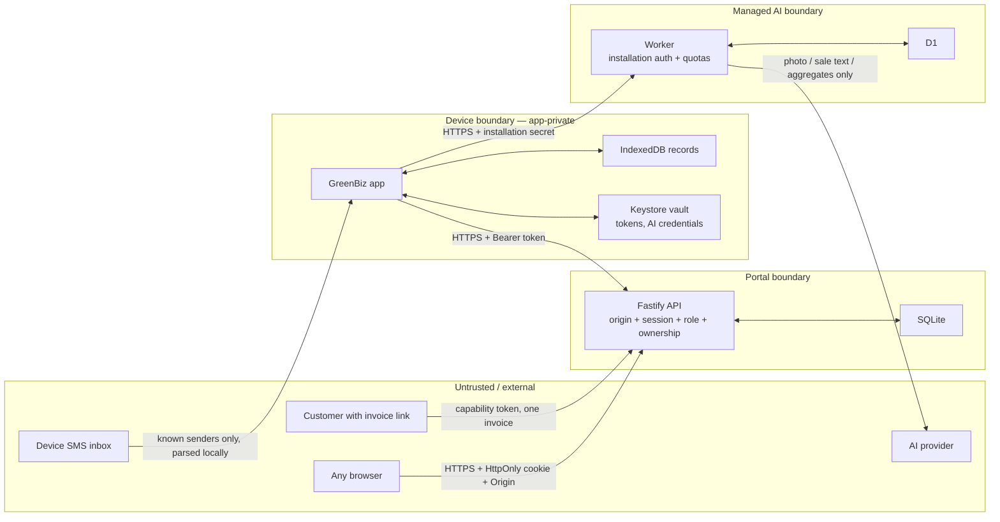

# GreenBiz — Technical Documentation

> **Product:** GreenBiz — offline-first small-business app for shops in Bangladesh
> **Clients:** Android app (Capacitor + React), responsive browser app, public invoice page, bank portal
> **Backends:** optional cloud portal (Fastify + SQLite) and a managed AI service (Cloudflare Workers + D1)
> **Version:** 2.2.0
> **Last updated:** 2026-10-19
> **Audience:** engineers, reviewers, and anyone evaluating the system's correctness, privacy, or security posture

---

## Contents

1. [Product overview](#1-product-overview)
2. [System architecture](#2-system-architecture)
3. [Core algorithms](#3-core-algorithms)
4. [Security design](#4-security-design)
5. [Operations and deployment](#5-operations-and-deployment)
6. [API surface](#6-api-surface)
7. [Testing strategy](#7-testing-strategy)
8. [Known limitations and residual risks](#8-known-limitations-and-residual-risks)
9. [File map](#9-file-map)

---

## 1. Product overview

GreenBiz helps a very small business owner answer four questions:

1. **What do I sell, and how much stock is left?** — inventory, measured stock and atomic sales.
2. **What money actually moved?** — bKash, Nagad, Rocket, Upay and bank SMS read **on the phone**, plus manual entries, classified as business or personal.
3. **How does my business look to a lender?** — two explainable, rule-based indicators: a 0–100 credit profile and a 300–900 internal indicator.
4. **Which loan product could I comfortably repay?** — affordability matching across 39 published Bangladeshi SME products from 8 banks.

The main Android app is **local-first**. A shop owner taps **Create my shop** and every record lives in the app's private storage. No account, server or internet connection is needed for stock, sales, payments, reports, the credit profile or loan matching. A cloud account is optional and only needed for shared records, public invoice links and the bank portal.

### Design principles

| Principle | What it means in the code |
|---|---|
| **One domain engine** | `shared/domain.ts` is the only code that changes business records. The device, the browser and the server all call the same `applyAction()`. |
| **Local-first** | Device shops are stored in IndexedDB on the phone. Cloud shops keep an optimistic local copy and a durable queue of pending changes. |
| **Exact money** | Amounts are taka rounded to 2 decimals, but every sum and product is done in integer poisha. Quantity × price uses `BigInt`. No float error reaches a total. |
| **Explainable algorithms** | Scores and loan matches are rule-based and return `reasons[]`, `requirements[]` and `warnings[]`, not an opaque number. |
| **Privacy by construction** | SMS is parsed on the phone. Only structured fields are kept; the raw message never leaves the device and is never sent to an AI. |
| **Honest states** | A TrxID is a claim, not proof. No code path can mark a payment `verified`. AI suggestions always need review. |
| **Idempotent writes** | Every sale, payment and offline replay carries a request ID. A retry returns the same result; a changed retry is refused with `409`. |

### Technology stack

| Layer | Technology |
|---|---|
| Mobile client | Capacitor 6 (Android, min API 23, target API 36), React 19, TypeScript 5.9, Vite 7 |
| Native Android code | Java plugins: `SessionVault` (Keystore encryption), `BusinessTools` (SMS, speech, AI), `SmsPaymentReceiver` |
| Local persistence | IndexedDB via `idb-keyval`; Keystore-encrypted `SharedPreferences` for secrets |
| Cloud portal | Node.js 24, Fastify 5, built-in `node:sqlite` (WAL), Zod, bcryptjs, `@fastify/helmet`, `@fastify/rate-limit` |
| Managed AI service | Next.js-compatible Vinext on Cloudflare Workers, D1 (SQLite), Drizzle ORM, Zod |
| AI provider | OpenRouter → `google/gemini-3.8-flash` via `google-ai-studio/flex`, fallbacks disabled |
| Hashing | `@noble/hashes` SHA-256 on the client, Node `crypto` on the server, Web Crypto in the Worker |
| Tests | Vitest, Node test runner, Playwright, JUnit |

---

## 2. System architecture

### 2.1 High-level topology



**Why this shape?**

- **The phone is the system of record** for an ordinary shop. The app works on day one with no infrastructure.
- **The same domain code runs everywhere.** A sale is validated, priced and committed by identical logic on the phone and on the server, so the two can never disagree about stock or totals.
- **AI is a separate, minimal service.** It holds the only provider key, knows nothing about shops or accounts, and stores no prompts or answers. Users never enter a key or run a server.
- **The cloud portal is opt-in.** It exists for features that need a server by nature: multi-device accounts, public invoice links, and bank users.

### 2.2 Component responsibilities

| Component | Responsibility | Key files |
|---|---|---|
| **React UI** | Screens: Dashboard, Stock, Sell, Payments, Finance, Growth, Settings, Bank | `src/screens/**`, `src/components/**` |
| **App store** | Mode selection, shop switching, caching, sync queue, sign-out safety | `src/data/store.tsx` |
| **Domain engine** | Validates and applies every action atomically; dashboards; 300–900 indicator | `shared/domain.ts`, `shared/types.ts` |
| **Algorithms** | SMS parsing, cash-out tolerance, credit profile, loan matching, reports, sale text matching | `shared/sms.ts`, `tolerance.ts`, `credit-profile.ts`, `loans.ts`, `finance.ts`, `sale-entry.ts` |
| **Sync client** | Stable IDs for offline creates, optimistic replay of pending actions | `src/data/sync.ts` |
| **Native bridge** | Keystore vault, SMS inbox and live receiver, speech, personal-key AI calls, file export | `android/app/src/main/java/com/greenbiz/app/*.java` |
| **Portal API** | Auth, sessions, ownership, origin checks, idempotency, invoices, bank portal | `server/app.ts`, `server/validation.ts` |
| **Portal storage** | SQLite with WAL, migrations, transactions, online backup | `server/store.ts`, `server/*.sql`, `server/backup.ts` |
| **Managed AI** | Enrollment, authentication, quotas, request claims, provider call, output validation | `Managed-AI-Service/lib/mobile-ai.ts` |

### 2.3 Operating modes

The app has three modes. The mode decides where records live; the domain engine is the same in all three.

| Mode | Started by | Records live in | Needs |
|---|---|---|---|
| **Device shop** | *Create my shop* | IndexedDB on the phone, one workspace per shop | Nothing. Works fully offline. |
| **Sample shop** | *Explore sample shop* | A separate fictional workspace | Nothing. Cannot touch real records. |
| **Cloud account** | Sign in / register | Server SQLite, with an optimistic local cache and queue | An HTTPS GreenBiz portal |

Multiple shops are supported in every mode. Each shop has its own workspace, cache, queue and settings. Cache keys are scoped by **server origin, owner and shop**, so switching shops or accounts can never show one shop's data in another.

### 2.4 Request lifecycle (cloud portal)

Every authenticated mutation follows the same path.



Two details matter:

- **The client never sends a workspace.** It sends an *action* (`sale.create`, `product.save`, …). The server reads its own copy, applies the action and stores the result. Client-supplied user IDs, shop IDs or totals are never trusted.
- **One transaction per mutation.** The workspace, the idempotency fingerprint and any payment-claim row commit together under `BEGIN IMMEDIATE`. SQLite serialises writers, so two concurrent sales cannot both pass a stock check.

### 2.5 Data model

#### Business records (the workspace)

A shop's records are one JSON document validated by `shared/types.ts`:



Rules encoded in the domain engine:

- **Sales snapshot product names, prices and costs.** Deleting a product never changes sales history.
- **A receipt can be linked to at most one sale**, and a linked receipt cannot be reclassified or deleted.
- **Personal and INR records are kept but excluded** from business totals, reports and both scores.
- **Bounded growth:** 10,000 products, 100,000 sales, 100,000 payments, 100,000 transactions, 200 activity entries, 2,000 request fingerprints per shop.

#### Cloud portal tables (SQLite)



- **Deleting an account cascades** to its shops, workspaces, sessions, orders, offers, interests and dedupe rows.
- **Offers are authoritative rows** written only by bank sessions. They are joined into the workspace on read and stripped on write, so a merchant cannot forge an offer.
- **Migrations are numbered and append-only** (`schema.sql`, `migration-002…004.sql`). The server refuses a database whose schema is newer than itself.

#### Managed AI tables (D1)

| Table | Columns | Purpose |
|---|---|---|
| `installations` | `id`, `secret_hash`, `created_day` | One row per app install. Only the SHA-256 of the secret is stored. |
| `daily_usage` | `day`, `scope`, `subject`, `used` | Counters per UTC day for `global`, `device`, `ip` and `enroll-ip`. IP subjects are SHA-256 hashes. |
| `request_claims` | `installation_id`, `request_id`, `digest`, `task`, `status`, `created_day` | Reuse guard. Stores a digest and a status, never the prompt, image or answer. |

### 2.6 Offline write and sync path (cloud accounts)



**Idempotency is layered:**

| Layer | Key | Protects against |
|---|---|---|
| Domain engine | `[requestId, SHA-256(action)]`, last 2,000 | A retried sale decrementing stock twice |
| Portal `idempotency` table | `(shop, requestId)` → fingerprint, permanent | A retry after the local cache rolled over |
| Portal `sync_requests` table | `(shop, envelope id)` → fingerprint | A lost response replaying an offline envelope twice |
| Offline creates | client-generated `product.id` / `payment.id` | A queued sale targeting a different product on replay |
| SMS import | `sms-` + SHA-256(method + reference), plus tombstones | Rescanning the inbox re-adding a deleted receipt |
| Payment claims | `trx_id` across all merchants | One TrxID being claimed twice without a flag |
| Managed AI | `(installation, requestId)` claim | One request being charged twice by the provider |

Further rules:

- The sync envelope's `createdAt` must be within **90 days in the past and 5 minutes in the future**. A delayed offline sale keeps its original business date.
- At most **1,000 pending changes** per shop. Sign-out is blocked while any shop has unsynced changes.
- A conflict never silently overwrites the server. The owner exports the pending changes as JSON first, then discards them.

### 2.7 Deployment topology

| Component | Where it runs | Configuration |
|---|---|---|
| **Android app** | User's phone (APK) | Contains only the public managed-AI origin. No keys. |
| **Managed AI service** | Cloudflare Workers + D1, `https://greenbiz-ai-service.dearjelly6.chatgpt.site` | Hosted secrets: `OPENROUTER_API_KEY`, optional model, provider and daily limits |
| **Cloud portal (demo)** | `https://greenbizdemosite.sustgpt.com` — nginx + Let's Encrypt, systemd service | `NODE_ENV=production`, `PUBLIC_ORIGIN`, `DATABASE_PATH` |
| **Cloud portal (template)** | `App-Website/Dockerfile` + `deploy/compose.yml` + `deploy/Caddyfile` | `GREENBIZ_DOMAIN`, optional `OPENAI_API_KEY`, `OPENAI_VISION_MODEL` |
| **Local development** | Vite on `127.0.0.1:5173`, API on `127.0.0.1:8787` | `PUBLIC_ORIGIN=http://127.0.0.1:5173` |

- The reverse proxy serves the built frontend and forwards only `/api/*` to the Node process on localhost.
- Release builds **block cleartext HTTP** (`usesCleartextTraffic="false"`). Debug builds allow it only for `127.0.0.1`, `localhost` and the emulator host `10.0.2.2`.
- Production startup **refuses** an HTTP or missing `PUBLIC_ORIGIN`.

---

## 3. Core algorithms

### 3.1 Money representation

Amounts are stored as taka with at most two decimals, but **arithmetic is done in integer poisha**:

```ts
// shared/domain.ts
function cents(value: number): number {
  const result = Math.round((value + Number.EPSILON) * 100);
  if (!Number.isSafeInteger(result)) throw new Error('Money exceeds safe arithmetic limit');
  return result;
}
```

Quantity × price is the risky operation, because quantities have three decimals (1.375 kg). It is done in `BigInt`, with half-up rounding to the poisha:

```ts
export function multiplyMoney(value: number, count: number): number {
  const scaled = BigInt(cents(value)) * BigInt(Math.round(count * 1000));
  const rounded = (scaled + 500n) / 1000n;
  ...
}
```

Limits: a single money input is at most ৳1,000,000,000; quantities at most 1,000,000 with three decimals; a positive payment that rounds to zero poisha is rejected. Unsafe integers throw rather than lose precision.

### 3.2 SMS parsing pipeline

All parsing happens **on the phone**. The same rules are implemented twice: TypeScript (`shared/sms.ts`) for inbox import and Java (`SmsPaymentParser.java`) for the background receiver.



#### Sender allow-list

Numeric short codes must match **exactly**, so a personal number that happens to end in 16247 is never trusted.

| Provider | Senders |
|---|---|
| bKash | `16247`, `bKash`, `bKashApp` |
| Nagad | `16167`, `16248`, `Nagad`, `NagadLtd` |
| Rocket | `16216`, `16218`, `16222`, `Rocket`, `DBBL`, `DutchBangla` |
| Upay | `16268`, `Upay`, `UpayBD` |
| UPI (INR) | `HDFCBK`, `SBIUPI`, `SBIINB`, `ICICIB`, `AXISBK`, `KOTAKB`, `Paytm`, `GPay`, `PhonePe`, `BHIM`, with an optional 2-letter operator prefix |

#### Amount and direction

A message usually contains several numbers: the amount, a fee and a balance. The parser walks the currency amounts in order and picks **the first one that belongs to a transfer phrase**:

- **Inflow** phrases: *received*, *received payment*, *cash in*, *credited*, *add money*, *deposited*, *পেয়েছেন*.
- **Outflow** phrases: *sent*, *send money*, *payment*, *cash out*, *debited*, *paid*, *পাঠিয়েছেন*.
- The phrase may come before the amount (*received Tk 500*) or after it (*৳500 has been credited*, *500 টাকা পেয়েছেন*).
- Any amount whose preceding label is *balance*, *available*, *fee*, *charge*, *limit* or *due* is skipped.

#### Privacy and identity

- The counterparty phone number is **masked to its last four digits** before it is stored.
- The record ID is `sms-` + SHA-256 of `method:reference`. The same payment seen twice (inbox copy, live alert, rescan) produces the same ID, so it is imported once.
- The raw message text is kept only in the on-device review queue so the owner can read it before importing. It is **never stored in the workspace, synced, or sent to an AI**.
- Imported receipts start as **personal**. The owner swipes right (business) or left (personal).

### 3.3 Sale atomicity and payment matching

A sale changes two things that must never disagree: stock goes down and money comes in. `applyAction()` works on a `structuredClone` of the workspace and returns either a fully updated copy or throws, so a sale is all-or-nothing.



#### Cash-out tolerance

A mobile-money confirmation rarely matches the bill exactly: the customer adds the cash-out charge (about ৳10–20 per thousand), or the shop absorbs it. The accepted band is:

$$
\text{tolerance} = \max\left(100\ \text{poisha},\ \left\lfloor \frac{20 \times \text{bill}_{\text{poisha}}}{1000} \right\rfloor\right)
$$

That is **at least ৳1, or 2% of the bill**:

| Bill | Tolerance | Accepted receipt |
|---:|---:|---|
| ৳30 | ৳1 | ৳29–৳31 |
| ৳500 | ৳10 | ৳490–৳510 |
| ৳1,000 | ৳20 | ৳980–৳1,020 |
| ৳10,000 | ৳200 | ৳9,800–৳10,200 |

Inside the band, the sale keeps its own total and the receipt keeps the amount that actually moved; the row is labelled, for example, *+৳15 cash-out charge*. Outside the band, the app asks first and then records the sale and the payment separately.

The payment picker shows messages from the **last 10 minutes** first, closest amount first, because a confirmation lands a minute or two after the customer pays. *Look further back* opens the last 30 days.

### 3.4 Credit profile (0–100)

The behavioural credit profile is rule-based. Every factor can be explained in one sentence.

$$
\text{score} = 0.30 \cdot C + 0.25 \cdot V + 0.25 \cdot S + 0.20 \cdot A
$$

| Factor | Weight | Definition | Why it matters |
|---|---:|---|---|
| **Consistency** `C` | 0.30 | `(1 − CV) × 100` of inflow across 13 weekly buckets; empty weeks count against it; needs inflow in ≥ 2 weeks | Steady weekly sales are more predictable than one spike |
| **Volume** `V` | 0.25 | Average monthly inflow ÷ **৳20,000** reference turnover | Puts the score on the scale of a microbusiness |
| **Stability** `S` | 0.25 | `(1 − CV) × 100` of month-by-month inflow; needs ≥ 2 months | Rewards revenue that does not collapse month to month |
| **Activity** `A` | 0.20 | Days with any record in the last 90 ÷ 90 | Distinguishes an active shop from a dormant one |

`CV` is the coefficient of variation (standard deviation ÷ mean). Each factor is clamped to 0–100.

Implementation details:

- **Window:** trailing 90 days. **Inputs:** sales, plus unlinked business BDT receipts and expenses. A receipt linked to a sale counts once, as the sale. Personal and INR records are excluded.
- **Monthly average divisor:** the observed span, floored at 30 days and capped at 90, so three good days are never extrapolated tenfold.
- **Bands:** ≥ 70 *Strong*, ≥ 40 *Building*, > 0 *Early*, otherwise *No data yet*.
- **Risk flags:**

  | Flag | Trigger |
  |---|---|
  | `no_activity` | No records in 90 days |
  | `insufficient_history` | Fewer than 10 records |
  | `no_inflow` | No money in recorded |
  | `low_activity` | Records on fewer than 15% of days |
  | `high_volatility` | Monthly CV above 0.6 |
  | `revenue_declining` | Latest month below 70% of the previous month |
  | `counterparty_concentration` | One payer above 85% of inflow (with ≥ 2 payers) |

- ***What to work on*** lists a tip for each factor scoring under 60, weakest weighted factor first.
- `computeCreditProfile()` is pure: the same records and clock always give the same profile.

### 3.5 Internal business indicator (300–900)

Bank users see a second, simpler indicator. It is computed in `creditScore()` on business dates in **Asia/Dhaka**:

$$
\text{indicator} = 300 + 1.8\,c + 1.8\,d + 1.2\,t + 120 \cdot \min\left(\frac{\text{days}}{90}, 1\right)
$$

| Component | Max points | Definition |
|---|---:|---|
| Base | 300 | Fixed |
| Consistency `c` | 180 | Distinct record days in the last 30 business dates ÷ 30 |
| Digital share `d` | 180 | Non-cash share of business income in the last 30 days |
| Turnover `t` | 120 | 30-day income ÷ current stock cost, capped at 2× |
| History | 120 | Distinct record days, capped at 90 |

The indicator is `null` until there are positive sales or business income on **at least 7 distinct days**. It is labelled an internal estimate, not a bureau score or a lending decision.

### 3.6 Loan affordability matching

The catalogue is **39 published Bangladeshi SME loan and working-capital products from 8 banks** (BRAC, Sonali, EBL, DBBL, Jamuna, Dhaka, Prime, City), last checked on 2026-10-18. Matching runs entirely on the device.

#### Instalment maths

For an amortising term loan with monthly rate $r$ and $n$ months:

$$
r = \frac{\text{annual rate (\%)}}{12 \times 100}
\qquad
\text{EMI} = P \cdot \frac{r(1+r)^n}{(1+r)^n - 1}
$$

The inverse — how much principal a given EMI supports — is:

$$
P = \text{EMI} \cdot \frac{(1+r)^n - 1}{r(1+r)^n}
$$

For a revolving, interest-only or bullet facility the displayed monthly cost is interest only, $P \cdot r$. Affordability is still tested **as if the principal were repaid over the tenor**, otherwise every cash-credit line would look 30× affordable.

#### Priority bands

| Monthly revenue ÷ instalment | Band | UI label |
|---:|---|---|
| **≥ 2.0×** | High | *High priority* |
| **1.3× – 2.0×** | Medium | *Good fit* |
| **< 1.3×** | Low | *Stretch* |
| no published rate | Unknown | *Terms on request* |

A small epsilon (`0.005`) absorbs rounding so a true 2.00× is never labelled medium.

#### Capacity estimate

$$
\text{Affordable EMI} = 0.50 \times \text{average monthly business revenue}
$$

1. Compute the affordable principal from each plan's lowest stated rate and published tenor (default 36 months).
2. Clamp it to the plan's `[minAmount, maxAmount]` band.
3. Round **down** to a whole ৳1,000 so the instalment never exceeds the 50% ceiling.
4. Pick the largest high-priority plan, then medium, then any; prefer term loans with tenor ≤ 72 months.
5. If nothing can be sized, show a labelled **12% / 36-month benchmark**.
6. With no business revenue recorded, ask for at least a month of records instead of estimating.

#### Ranking

Each plan gets a fit score from 0 to 1:

| Component | Weight | Measure |
|---|---:|---|
| Affordability | 0.55 | `min(coverage / 3, 1)`; 3× cover is full marks |
| Cost | 0.25 | `1 − (rate − 4%) / 16%`, clamped; 4% scores 1, 20% scores 0 |
| Institution trust | 0.12 | Commercial bank 1.0, other 0.8; × 0.9 without a published source URL |
| Eligibility fit | 0.08 | −0.4 requested amount outside band, −0.3 revenue below minimum, −0.2 business too young |

Plans are sorted by **priority, then fit score, then lower instalment**. The top 12 are shown, and the plan behind the headline estimate is always included.



Every match carries `reasons[]` (instalment, coverage, suggested amount), `requirements[]` (collateral, guarantors, business age, trade licence, owner age, women-led) and `warnings[]`. The app calls every figure an **estimate from published terms**; collateral, CIB history and documents are listed, not verified.

A separate **borrowing planner** (Growth screen) answers *"how much could I borrow if I set aside X% of revenue?"* with a configurable annuity: default 15% of revenue (1–50%), 12% a year, 36 months (1–120).

### 3.7 Sale entry by voice or text

The owner can say or type a sale such as *"2 kg rice and 3 soap"*. Two matchers exist:

- **Offline matcher** (`shared/sale-entry.ts`): splits on commas, *and*, *plus*, *এবং*, *আর*; normalises Bengali digits; reads a leading or trailing quantity (up to 3 decimals); matches a product by exact name, then by substring. A line is accepted only if **exactly one** product matches and stock covers the quantity. Everything else goes to *unmatched*. It never guesses.
- **Managed AI matcher**: sends the sentence plus `{id, name, unit, available}` for each product. The service and the app both reject any product ID that was not supplied, any quantity above available stock, and duplicate lines.

Either way the result is a draft the owner reviews before the sale is saved.

### 3.8 Managed AI request pipeline



#### Quota reservation

Quotas are counted per UTC day. The reservation is safe under concurrency:

1. A read rejects the request if any counter is already at its cap, **without writing anything**.
2. One D1 batch runs a conditional UPSERT per counter:
   ```sql
   INSERT INTO daily_usage (day, scope, subject, used) VALUES (?, ?, ?, 1)
   ON CONFLICT(day, scope, subject) DO UPDATE SET used = used + 1 WHERE used < ?
   RETURNING used
   ```
   A counter at its cap returns no row, so concurrent requests can never push it past the cap.

| Limit | Default | Hosted setting (max) |
|---|---:|---|
| Global requests per day | 200 | `GLOBAL_DAILY_LIMIT` (10,000) |
| Requests per installation per day | 20 | `DEVICE_DAILY_LIMIT` (1,000) |
| Requests per IP per day | 100 | `IP_DAILY_LIMIT` (5,000) |
| New enrollments per IP per day | 10 | fixed |

Failures are conservative: a failed provider call still consumes quota, and a claim is never reused, so the provider is never charged twice for one request ID.

#### Task contracts

| Task | Input | Output |
|---|---|---|
| `stock` | `{image}` — JPEG/PNG/WebP data URL, ≤ 5 MiB | `{products:[{name, category, unit, description, quantity, cost, price, lowAt}]}`, max 20; unknowns are 0 |
| `sale` | `{sentence ≤ 1000, products ≤ 500}` | `{items:[{productId, quantity}], unmatched:[]}` using supplied IDs only |
| `advice` | `{question ≤ 1000, aggregates}` — income, expenses, net, activeDays, digitalShare, stockItems, lowStockItems. The question starts with a context line: topic, credit profile score, average revenue and borrowing estimate | Short plain text |

### 3.9 Reports and business time

- All daily, weekly and monthly figures use **Asia/Dhaka** business dates, not UTC.
- Period presets: 7 days, 30 days, this week, this month, last month, last 90 days, this year, pick a month, custom. **Weeks start on Saturday**, the first working day in Bangladesh.
- Each report compares against the equal preceding period and groups bars by day, week or month.
- The overview shows average sale, best day/week/month, top method, top payer, and the period's payments. CSV export includes payer and reference.
- A linked receipt is counted once, as its sale. Personal and INR records are shown but excluded from business totals.

---

## 4. Security design

### 4.1 Threat model and trust boundaries



The main assets to protect are:

1. **Account and shop access** — a stolen token or a guessed ID must not expose another shop.
2. **Commercial data** — inventory, prices, sales, receipts, scores.
3. **Restricted personal data** — SMS text, counterparty phone numbers, transaction references.
4. **Server credentials** — the OpenRouter key and the portal's database.
5. **AI spend** — an anonymous caller must not be able to drain the provider budget.
6. **Payment integrity** — nothing may present a customer's claim as a verified payment.

### 4.2 Data classification

| Class | Examples | Who can read it | Where it lives |
|---|---|---|---|
| **Public** | Loan catalogue, institution list, scoring formulas | Anyone | App bundle |
| **Capability** | One invoice: shop name, items, total, bKash number | Anyone holding its 64-hex-character link | `orders` |
| **Account** | Email, role, shop profile | The owner only | `users`, workspace `shop` |
| **Commercial** | Products, sales, receipts, reports, scores | The owner; a consenting shop's **aggregates** to bank users | Workspace |
| **Restricted (PII)** | Raw SMS text, full phone numbers | The owner, **on the phone only** | Native review queue; never synced |
| **Secret** | Session tokens, AI credentials, provider key | Nobody in plain text | Keystore vault, SHA-256 hashes, hosted secrets |

The critical rules: **raw SMS never leaves the phone**, and **a bank user only ever sees aggregates** of a shop that has switched sharing on.

### 4.3 Permission tiers

#### User roles

| Tier | How it is granted | Can do | Cannot do |
|---|---|---|---|
| **Anonymous** | — | Health check, view one invoice by link, submit a TrxID claim for it | Read any other invoice, inventory, sales, owner email |
| **Device owner** | Installs the app | Everything on their device shops | Reach any server or other device |
| **Merchant** | Public registration | Their own shops' records, invoices, offers, interest, export, account deletion | Read other merchants; act as a bank; self-verify a payment |
| **Bank** | **Created only by an administrator** with shell access (`server/admin.ts create-bank`) | List consenting shops' aggregate profiles; send offers and document requests; read interest in their own offers | See products, customers, SMS or transactions; see non-consenting shops; read other banks' interest |
| **Administrator** | Shell / database access | Provision bank users, back up and restore | — (no admin HTTP route exists) |

#### Android permissions

| Permission | Why | When requested |
|---|---|---|
| `INTERNET` | Managed AI and optional portal | Install time |
| `READ_SMS` | 90-day inbox import of payment messages | Only when the owner enables payment-message access |
| `RECEIVE_SMS` | Live *Payment received* prompt | Same opt-in toggle; the receiver does nothing while it is off |
| `POST_NOTIFICATIONS` | Payment alerts (Android 13+) | When alerts are enabled |
| `RECORD_AUDIO` | Voice sale entry | First use of the microphone |
| Camera (Capacitor) | Product photos | First use of the camera; hardware is optional |

Further Android hardening:

- `allowBackup="false"`: records and the vault are excluded from cloud backup.
- The SMS receiver requires the `BROADCAST_SMS` permission, so only the system can trigger it.
- The internal *payment ready* broadcast is package-scoped and registered `RECEIVER_NOT_EXPORTED`.
- Payment notifications use private visibility: the lock screen shows only *GreenBiz payment message*, not the amount.
- Exported files go through a `FileProvider` with temporary read grants; exports older than 24 hours are removed.

### 4.4 Authentication

#### Cloud portal

| Control | Implementation |
|---|---|
| Password policy | 10–72 characters, ≤ 72 UTF-8 bytes, at least 3 of lowercase / uppercase / digits / symbols |
| Password hashing | bcrypt, cost 12 |
| Unknown email | A real bcrypt compare against a dummy hash, so timing does not reveal whether an account exists; one generic error |
| Session token | 32 random bytes (256 bits), hex; **only SHA-256 is stored** |
| Lifetime | 7-day absolute TTL; logout and logout-all revoke immediately |
| Web transport | `greenbiz_session` cookie: `HttpOnly`, `SameSite=Strict`, `Secure` in production; the token is never in JSON |
| Native transport | `x-greenbiz-client: native` → token returned once, then `Authorization: Bearer`; stored in the Keystore vault |
| Cookie + native origin | A request from a Capacitor origin **cannot** authenticate with a cookie |
| Account deletion | Requires the password again; cascades every owned record |
| Password recovery | Returns `503` and says plainly that no email was sent (no mail service is configured) |

#### Managed AI service

| Control | Implementation |
|---|---|
| Credential | The app generates a UUID installation ID and a 256-bit secret, stores them in the Keystore vault, and enrolls once |
| Storage | The service keeps only SHA-256(secret); comparison is constant-time |
| Rotation | Re-enrolling the same ID with a different secret returns `409`; one install cannot take over another |
| Transport | `Authorization: Bearer <secret>` + `x-greenbiz-installation`; credentials in the body are rejected |
| Honest limit | Enrollment is **not device attestation**. The global daily cap is the final spend guard. |

### 4.5 Authorisation and tenant isolation

- **Every private route checks the role** (`merchant` or `bank`) after authenticating the session.
- **Shop selection is verified.** The optional `x-greenbiz-shop` header must name a shop owned by the caller; otherwise `404`. A `403` would confirm that the ID exists.
- **Mutations take actions, not documents.** The server derives the shop from the session and the header, never from the body.
- **Bank identity comes from the session.** An offer's `bank_id` is the authenticated bank's ID; the display label is cosmetic.
- **Consent is checked on every bank read and write.** Turning sharing off hides the shop, its offers and its interest history from bank views immediately.
- **Invoice claims derive everything from the stored invoice:** customer, invoice ID and exact amount. A customer can only send a 10-character TrxID.
- **Invoice links fail closed.** If a stored payment does not match the invoice's ID, customer, amount and channel, the public view returns `409` instead of showing it.

### 4.6 Input validation and error contract

- **Zod at every boundary**, with `.strict()` objects: unknown fields are rejected, including a `role` in registration and `model` / `provider` / `endpoint` overrides in AI requests.
- **Bounded everything:** text lengths, 1–200 cart lines, 1–1,000 imported records per batch, 7 MB request body, 45-second request timeout.
- **Images are verified, not trusted:** data URL only (no external URLs), valid base64, ≤ 5 MB, and the file signature must match the declared type (JPEG `FF D8 FF`, PNG header, WebP `RIFF…WEBP`).
- **One error shape:** `{ "error": "Readable message" }`. Validation errors list at most three issues. Unexpected errors return a generic `500` message. Stack traces and SQL never reach the client.
- **Parameterised SQL only** in both backends. No request input is ever interpolated into a query.

### 4.7 Secrets and API keys

| Secret | Where it lives | Never |
|---|---|---|
| `OPENROUTER_API_KEY` | Cloudflare hosted secret | In the APK, the repository, a log line or a response |
| `OPENAI_API_KEY` (optional portal AI) | Server environment | In the browser or Android bundle |
| Portal session tokens | Client: Keystore vault or HttpOnly cookie. Server: SHA-256 only | In `localStorage`, JSON responses to web clients, or logs |
| Managed-AI installation secret | Keystore vault; service stores SHA-256 only | Sent anywhere but the managed service |
| Personal AI key (advanced, optional) | Keystore vault (Android) or memory only (browser) | On any GreenBiz server |
| Android release keystore | Owner's build environment via `GREENBIZ_KEYSTORE`, `GREENBIZ_STORE_PASSWORD`, `GREENBIZ_KEY_ALIAS`, `GREENBIZ_KEY_PASSWORD` | In the repository |

Rules enforced in code and config:

- `.gitignore` blocks `.env*`, `*.jks`, `*.keystore`, `*.pem`, databases and build output. Only `.env.example` with empty values is committed.
- The portal's logger is **disabled**, so tokens, cookies and invoice links cannot leak into application logs.
- The managed service never returns provider bodies, headers or exception text. Failures map to fixed messages such as *GreenBiz AI is busy*.
- An AI response that contains the provider key or the caller's credential — even through JSON Unicode escapes — is rejected.
- Changing the provider key needs **no app rebuild**; the APK only knows the service's public origin.

### 4.8 Transport and storage

| Path | Protection |
|---|---|
| App → managed AI | HTTPS only; `credentials: 'omit'`; `redirect: 'error'` |
| App → portal | HTTPS (cleartext blocked in release builds); Bearer token |
| Browser → portal | HTTPS via reverse proxy; HttpOnly `SameSite=Strict` cookie; Origin check on every mutation |
| Worker → OpenRouter | HTTPS; `redirect: 'manual'` and any redirect rejected, so the key is never forwarded |
| Device records | IndexedDB in app-private storage; excluded from Android backup |
| Device secrets | AES-GCM with a non-exportable key in Android Keystore; the storage key name is bound as additional authenticated data |
| Portal database | SQLite on a private volume, owned by a dedicated service user; `PRAGMA foreign_keys=ON`, WAL, `synchronous=FULL` |
| Portal backups | SQLite online backup API, `integrity_check` verified, never overwrites an existing file |

### 4.9 SMS privacy

This is the most sensitive data path in the product, so it is designed to stay on the phone.

**Read on the device:**

- Only when the owner turns on payment-message access **and** grants `READ_SMS` / `RECEIVE_SMS`.
- Only messages from the allow-listed payment senders in §3.2. Personal messages, OTPs and promotions are ignored.
- The inbox scan reads at most the last **90 days** and **1,000** payment messages.

**Kept on the device:**

- Structured fields only: amount, direction, method, currency, reference, masked party, time.
- The raw message is held in the native review queue (max 500 entries) so the owner can check it, then dropped once acknowledged.

**Sent anywhere else:**

- **Nothing raw.** Imports to a cloud account carry structured records only; the server schema has no field for message text.
- **AI never sees SMS.** Advice receives seven 30-day aggregates (income, expenses, net, active days, digital share, stock items, low-stock items) and one context line with the credit profile score, average revenue and borrowing estimate. Personal records are excluded from all of them.

This is a deliberate change from GreenBiz 1.x, which uploaded raw SMS bodies to its server and could send them to an AI parser.

### 4.10 Web hardening

| Header / control | Value |
|---|---|
| `Cache-Control` | `no-store` on every API response, including public invoices |
| `Referrer-Policy` | `no-referrer` (keeps invoice capability links out of referrers) |
| Helmet defaults | `X-Content-Type-Options: nosniff`, `X-Frame-Options`, HSTS, CSP and related headers |
| `Cross-Origin-Resource-Policy` | `same-site` |
| CORS | Only `PUBLIC_ORIGIN` and the three Capacitor origins; the Capacitor origins can never authenticate with a cookie (§4.4) |
| Origin check | Every `POST`/`DELETE` must come from `PUBLIC_ORIGIN`, or be a native request without a cookie |
| Rate limits | 300 requests / IP / 15 min overall; 10 / 15 min on each auth and AI route; 20 / 15 min on public invoice claims |
| Managed AI CORS | Fixed allow-list: the service origin, `https://localhost`, `http://localhost`, `capacitor://localhost`, `http://127.0.0.1:5173` |

### 4.11 AI-specific safety

| Risk | Control |
|---|---|
| **Prompt injection** via photo labels or sale text | System prompt treats all user content as untrusted data; output must match a strict schema |
| **Hallucinated money or products** | Unknown counts and prices must be 0; sale output may only use supplied product IDs within available stock; everything is a reviewed draft |
| **Endpoint / model override** | Fixed endpoint, model, provider and token budget on the server; override fields rejected by schema |
| **Key leakage** | Key only in hosted secrets; never logged or echoed; redirects refused; output scanned for the key and credential |
| **Spend abuse** | Installation auth + per-device, per-IP and global daily caps + enrollment cap; reserved before the provider call |
| **Double charge** | Durable request claim inserted before the call; a reused request ID never reaches the provider |
| **Unbounded output** | `max_tokens` 2048; response read capped at 128 KiB; text over 16,000 characters rejected; `finish_reason` must be `stop` |
| **Personal data in prompts** | Advice gets aggregates and scores only; no SMS, customer names, phone numbers or references; nothing is stored by the service |

### 4.12 Residual risks

These are real gaps, not hypothetical ones.

| Risk | Status |
|---|---|
| **No authoritative payment verification** | A TrxID or SMS is evidence, not proof. An approved bKash/Nagad API integration is required before claiming verification. |
| **Owner can edit their own records** | A motivated owner could inflate sales. Both scores are labelled self-recorded; a lender must verify independently. |
| **Anonymous AI enrollment** | Not device attestation. Someone can create many installations; the global cap bounds request count, not currency spend. Provider-side spending limits are needed. |
| **In-memory portal rate limits** | Reset on restart and see the proxy IP behind a reverse proxy. An upstream per-client limiter is needed for scale. |
| **Single-node SQLite portal** | No horizontal scaling or shared session store. Fine for a pilot, not for many concurrent shops. |
| **No password recovery** | No mail service is configured; recovery honestly reports unavailable. |
| **Device data loss** | Uninstalling or clearing app data deletes device shops. Export exists; automatic backup import does not. |
| **SMS permission policy** | `READ_SMS` / `RECEIVE_SMS` are restricted on Google Play and need a declaration or sideloading. |
| **AI text can contain personal details** | Free-text questions and sale sentences go to OpenRouter as typed. Schemas are structural, not a PII detector. |
| **Debug-signed APK** | The published APK is for testing. Release signing and Play review have not been done. |

---

## 5. Operations and deployment

### 5.1 Commands

```powershell
# App, website and portal API (Node 24)
cd App-Website
npm ci
npm run lint                     # ESLint, zero warnings allowed
npm run typecheck                # strict TypeScript
npm test                         # 108 unit and API tests (Vitest)
npm run build                    # web bundle -> dist/
npm run build:server             # API bundle -> server-dist/
npx playwright install chromium
npm run test:ui                  # 23 browser journeys (API must be running)

# Local development: two terminals
$env:PUBLIC_ORIGIN = 'http://127.0.0.1:5173'
$env:DATABASE_PATH = './data/greenbiz.sqlite'
npm run server                   # API on http://127.0.0.1:8787
npm run dev                      # app on http://127.0.0.1:5173

# Android (Java 17, Android SDK 36)
npm run android:sync
cd android
.\gradlew.bat testDebugUnitTest assembleDebug --no-daemon

# Managed AI service
cd Managed-AI-Service
npm ci
npm test                         # 24 tests (Node test runner)
node node_modules/typescript/bin/tsc --noEmit
npm run build
```

### 5.2 Configuration

| Variable | Component | Purpose |
|---|---|---|
| `NODE_ENV` | Portal | `production` enables Secure cookies and the HTTPS origin requirement |
| `PUBLIC_ORIGIN` | Portal | Exact public origin, e.g. `https://greenbiz.example.com`; used for CORS, Origin checks and invoice links |
| `DATABASE_PATH` | Portal | SQLite file on persistent local storage |
| `HOST`, `PORT` | Portal | Listener, default `127.0.0.1:8787` |
| `OPENAI_API_KEY`, `OPENAI_VISION_MODEL` | Portal (optional) | Server-side photo and advice routes; unset → honest `503` |
| `OPENROUTER_API_KEY` | Managed AI | Provider key (hosted secret) |
| `OPENROUTER_MODEL`, `OPENROUTER_PROVIDER` | Managed AI | Default `google/gemini-3.8-flash`, `google-ai-studio/flex` |
| `GLOBAL_DAILY_LIMIT`, `DEVICE_DAILY_LIMIT`, `IP_DAILY_LIMIT` | Managed AI | Daily caps (§3.8) |
| `VITE_GREENBIZ_AI_SERVICE` | App build | Override the managed AI origin |

The portal does **not** load `.env` files; variables come from the shell or the service manager.

### 5.3 Health

```json
// GET /api/health  (portal)
{ "status": "ok", "ai": false, "bkashVerification": false, "passwordRecovery": false, "persistence": "sqlite" }

// GET /api/health  (managed AI)
{ "status": "ok", "ai": true, "model": "google/gemini-3.8-flash" }
```

The portal reports capabilities honestly: `bkashVerification` and `passwordRecovery` are always `false`. The managed service reports `ai: true` only when the key is set **and** all three D1 tables can be read; it never calls the provider to answer a health check.

### 5.4 Backup and restore

```powershell
$env:DATABASE_PATH = '/var/lib/greenbiz/greenbiz.sqlite'
npx tsx server/backup.ts '/backups/greenbiz-2026-10-19.sqlite'
```

The backup uses SQLite's online backup API (includes committed WAL pages), refuses to overwrite an existing file, and runs `PRAGMA integrity_check` on the copy. To restore: stop the service, keep the current files aside, point `DATABASE_PATH` at a verified copy, start, and check health and a sign-in.

### 5.5 Observability

- The portal's request logger is off by design: bearer tokens, cookies and invoice links must not be captured.
- The managed service returns fixed error messages and, at most, a transport category or numeric HTTP status (`provider_timeout`, `provider_http_500`). It logs no prompts, images or answers.
- Usage is visible in `daily_usage` (counts only) and in the OpenRouter dashboard.

---

## 6. API surface

### Cloud portal

All routes are under `/api` and return JSON. Errors are `{ "error": "…" }`.

#### Public

| Method | Path | Notes |
|---|---|---|
| `GET` | `/api/health` | Capabilities; no secrets |
| `GET` | `/api/public/orders/:token` | One invoice by its 64-hex capability token |
| `POST` | `/api/public/orders/:token/claim` | `{trxId}` only; 20 / IP / 15 min |

#### Auth (10 / IP / 15 min each)

| Method | Path | Notes |
|---|---|---|
| `POST` | `/api/auth/register` | Creates a merchant with an empty workspace; never a bank |
| `POST` | `/api/auth/login` | Generic invalid-credential error |
| `GET` | `/api/auth/me` | Current user |
| `POST` | `/api/auth/logout` · `/logout-all` | Revoke this session or all sessions |
| `DELETE` | `/api/auth/account` | Password required; cascades |
| `POST` | `/api/auth/forgot-password` | `503`, no email sent |

#### Merchant

| Method | Path | Notes |
|---|---|---|
| `GET` | `/api/workspace` | The selected shop's workspace |
| `POST` | `/api/actions` | One action; returns the new workspace |
| `POST` | `/api/sync` | Offline envelope `{id, baseVersion, action, createdAt}` |
| `GET` | `/api/export` | Workspace JSON as a download |
| `GET`/`POST` | `/api/shops` | List / create branches (max 100) |
| `DELETE` | `/api/shops/:id` | Exact name confirmation; refuses the last shop |
| `GET`/`POST` | `/api/orders` | List / create invoice links |
| `POST` | `/api/offers/:id/interest` | Express interest; requires sharing consent |
| `POST` | `/api/ai/stock` · `/api/ai/advisor` | Optional server AI; 10 / IP / 15 min |

#### Bank (administrator-provisioned)

| Method | Path | Notes |
|---|---|---|
| `GET` | `/api/bank/businesses` | Aggregate profiles of consenting shops |
| `POST` | `/api/bank/offers` | Loan or grant offer to a consenting shop |
| `POST` | `/api/bank/document-requests` | Adds a notification to the shop's activity |
| `GET` | `/api/bank/interests` | Interest in this bank's offers only |

#### Actions accepted by `/api/actions` and `/api/sync`

```ts
{ type: 'product.save', create?: true, product: {...} }
{ type: 'product.delete', id }
{ type: 'sale.create', items: [{productId, quantity}], method, channel, customer, requestId, transactionId? }
{ type: 'transaction.import', transactions: [...], requestId }
{ type: 'transaction.classify', id, business }
{ type: 'transaction.delete', id }
{ type: 'payment.create', id?, customer, order, channel, amount, trxId, requestId }
{ type: 'payment.review', id, decision: 'manual' | 'rejected', received?, note }
{ type: 'shop.update', shop: {...} }
```

### Managed AI service

| Method | Path | Notes |
|---|---|---|
| `GET` | `/api/health` | `{status, ai, model}` |
| `POST` | `/api/mobile/enroll` | `{installationId: UUID, secret: 64 hex}`; idempotent |
| `POST` | `/api/mobile/chat` | Headers `Authorization: Bearer <secret>`, `x-greenbiz-installation: <UUID>`; body `{requestId, task, data}` → `{text}` |
| `OPTIONS` | all | CORS preflight for the allow-listed origins |

Full contracts: [`App-Website/docs/API.md`](App-Website/docs/API.md) and [`Managed-AI-Service/README.md`](Managed-AI-Service/README.md).

---

## 7. Testing strategy

All counts below were produced by running the suites on 2026-10-19.

| Suite | What it covers | Tests |
|---|---|---:|
| `shared/domain.test.ts` | Atomic sales, stock, retries, request-ID reuse, rounding, Dhaka dates, 300–900 indicator, imports, tombstones, receipt linking, currencies | 27 |
| `shared/sms.test.ts` | Amount vs balance, debit wording, Bengali digits, short codes, Upay, Bangla amounts, dedupe by reference | 14 |
| `shared/loans.test.ts` | EMI and inverse, interest-only, rounding to thousands, 39-product catalogue, 50% ceiling, requested amounts | 13 |
| `shared/credit-profile.test.ts` | Weights, empty shop, window, ৳20,000 reference, risk flags, business-only records | 6 |
| `shared/tolerance.test.ts` | Exact, cash-out and distant amounts | 6 |
| `shared/finance.test.ts` | Linked-sale cashflow, period comparison, borrowing estimate, calendar presets | 4 |
| `shared/sale-entry.test.ts` | Quantities, exact names, Bengali digits, refusing ambiguous matches | 2 |
| `server/app.test.ts` | Auth, cookies, origin checks, sessions, ownership, idempotent sales, sync replay, invoices, claims, bank consent, offers, interest, account deletion, AI honesty | 27 |
| `server/store.test.ts` · `backup.test.ts` | Migration 4 preserves legacy data; live WAL backup | 2 |
| `src/data/*.test.ts` | Personal key isolation, aggregate-only advice, AI product-ID checks, managed enrollment, stable offline IDs | 7 |
| **App unit + API total** | 13 files | **108** |
| `tests/*.spec.ts` (Playwright) | Device persistence, multi-shop isolation, SMS linking, offline restart, exact-once replay, conflicts, expired sessions, public invoice claims, cash-out attach, loan directory, reports, phone widths | **23** |
| `Managed-AI-Service/tests/mobile-ai.test.mjs` | Enrollment, auth, strict schemas, fixed provider request, redirects, request claims, concurrent quotas, UTC rollover, fail-closed config, timeouts, output validation, credential-echo rejection, real `workerd` transport | **24** |
| `SmsPaymentParserTest.java` (JUnit) | Native parser: filtering, debits, digits, short codes, stable identity | **4** |

Test design choices:

- **Real databases, no mocks.** API tests run Fastify `inject()` against temporary SQLite files; managed-AI tests run the generated D1 schema against in-memory `node:sqlite`.
- **Deterministic clocks** for business dates, session expiry and UTC quota rollover.
- **No live AI calls.** Provider tests use a controlled `fetch` transport and a fake test-only key.
- **CI** (`.github/workflows/app-ci.yml`) runs lint, typecheck, unit/API tests, both builds, `npm audit`, the Playwright journeys, the Android build with native tests, and the managed-AI tests on every push.

---

## 8. Known limitations and residual risks

### Product scope

- **No authoritative bKash/Nagad verification.** There is no provider integration; manual review stays labelled *manual*.
- **Loan plans are published terms**, not quotes. Expressing interest is not an application; nothing is disbursed.
- **Insurance products are not in the catalogue.** The advisor accepts an insurance question but there are no insurer rows.
- **Interface copy is English.** Bengali text, digits and the taka sign render with bundled fonts; a full Bengali translation is not done.
- **No automatic device-to-cloud migration** and no backup import UI.
- **Android only.** No iOS build or iOS secure storage.

### Security gaps

See §4.12 for the full table. The highest-priority items before a real launch are:

1. **Provider-backed payment verification** before any *verified* label.
2. **Provider-side spending limits** and monitoring for the managed AI key.
3. **Upstream rate limiting** in front of the portal.
4. **Release signing and Play SMS-permission declaration.**
5. **Mail-backed password recovery.**

---

## 9. File map

| Area | Important files |
|---|---|
| App entry and shell | `App-Website/src/main.tsx`, `src/App.tsx` |
| State, modes, sync queue | `src/data/store.tsx`, `src/data/sync.ts`, `src/data/api.ts` |
| Managed AI client | `src/data/managed.ts`, `src/data/business.ts` |
| Screens | `src/screens/Inventory.tsx`, `Payments.tsx`, `Transactions.tsx`, `Finance.tsx`, `Growth.tsx`, `Loans.tsx`, `Bank.tsx`, `Settings.tsx` |
| Checkout and payments | `src/components/CheckoutTools.tsx`, `PaymentPicker.tsx`, `LivePayment.tsx` |
| Domain engine | `shared/domain.ts`, `shared/types.ts` |
| Algorithms | `shared/sms.ts`, `tolerance.ts`, `credit-profile.ts`, `loans.ts`, `finance.ts`, `sale-entry.ts` |
| Loan catalogue | `shared/catalogue/plans.json`, `shared/catalogue/institutions.json` |
| Android native | `android/app/src/main/java/com/greenbiz/app/SessionVaultPlugin.java`, `BusinessToolsPlugin.java`, `SmsPaymentReceiver.java`, `SmsPaymentParser.java`, `PaymentInbox.java` |
| Android config | `android/app/src/main/AndroidManifest.xml`, `android/app/build.gradle`, `capacitor.config.ts` |
| Portal API | `server/app.ts`, `server/validation.ts`, `server/index.ts` |
| Portal storage | `server/store.ts`, `server/schema.sql`, `server/migration-00*.sql`, `server/backup.ts`, `server/admin.ts` |
| Deployment templates | `Dockerfile`, `deploy/compose.yml`, `deploy/Caddyfile` |
| Managed AI | `Managed-AI-Service/lib/mobile-ai.ts`, `app/api/**/route.ts`, `db/schema.ts`, `drizzle/` |
| Detailed docs | `App-Website/docs/API.md`, `SERVER.md`, `RELEASE.md`, `VALIDATION.md`, `FEATURES-2.0.md`, `FEATURES-2.1.md`, `MANAGED-AI.md` |

---

## Appendix A — Constants

| Constant | Value | Meaning |
|---|---:|---|
| Cash-out tolerance | `max(৳1, 2%)` | Receipt still counts as the bill's payment |
| Payment suggestion window | 10 minutes | Messages shown first in the picker |
| Payment history window | 30 days | *Look further back* |
| SMS inbox scan | 90 days, 1,000 messages | Import limit |
| Native review queue | 500 entries | Pending payment messages on the phone |
| Credit profile window | 90 days | Trailing window |
| `REFERENCE_MONTHLY_INFLOW` | ৳20,000 | Full marks on Volume |
| Credit factor weights | 0.30 / 0.25 / 0.25 / 0.20 | Consistency / Volume / Stability / Activity |
| Internal indicator | 300–900, ≥ 7 record days | Bank-facing estimate |
| `PRIORITY_RATIO_HIGH` / `MEDIUM` | 2.0 / 1.3 | Revenue ÷ instalment bands |
| `MAX_DEBT_SERVICE_RATIO` | 0.50 | Instalment ceiling for capacity |
| Benchmark loan | 12% / 36 months | When no product can be sized |
| Loan catalogue | 39 plans, 8 banks | Checked 2026-10-18 |
| Session TTL | 7 days | Portal |
| bcrypt cost | 12 | Portal password hashing |
| Request fingerprints | 2,000 per shop (domain), permanent (server) | Idempotency |
| Pending sync queue | 1,000 per shop | Offline limit |
| Sync timestamp window | −90 days / +5 minutes | Offline envelopes |
| Request body | 7 MB (portal), 5 MiB + 64 KiB (AI) | Upload ceiling |
| AI daily caps | 200 global / 20 device / 100 IP | Managed AI defaults |
| AI provider timeout | 45 s | One attempt, no fallback |
| AI output | 2,048 tokens, 128 KiB, 16,000 chars | Bounds |

## Appendix B — Glossary

| Term | Meaning |
|---|---|
| **Poisha** | 1/100 of a taka; the unit used for exact arithmetic |
| **Workspace** | One shop's complete set of records as a versioned JSON document |
| **Action** | A typed change request (`sale.create`, …) applied by the domain engine |
| **Request ID** | Client-chosen ID that makes a write idempotent |
| **Sync envelope** | A queued offline action with the workspace version it was based on |
| **Receipt** | A `FinancialTransaction` — money in or out, from SMS or entered manually |
| **Linked receipt** | A receipt attached to a sale; counted once, as the sale |
| **Payment claim** | A customer-entered TrxID for an invoice; never proof of payment |
| **EMI** | Equated Monthly Instalment |
| **CV** | Coefficient of variation: standard deviation ÷ mean |
| **Installation credential** | UUID + 256-bit secret the app uses to call the managed AI service |
| **D1** | Cloudflare's SQLite-based database |
